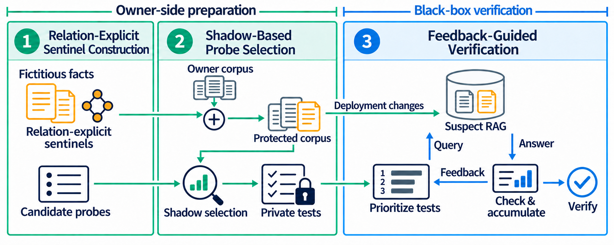
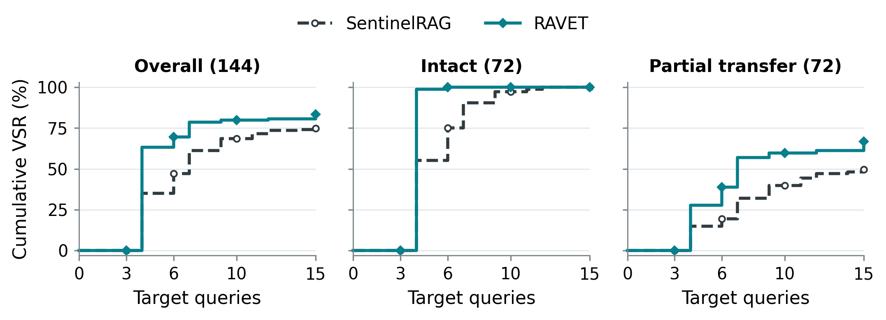
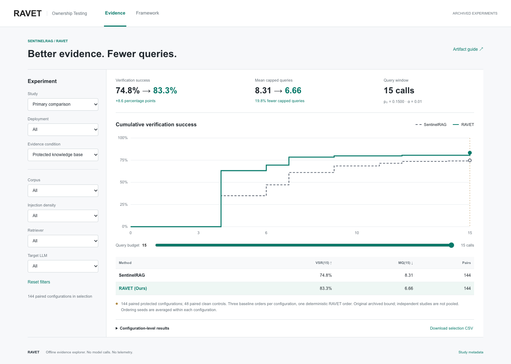

<div align="center">

# RAVET

### Query-Efficient Ownership Testing for RAG Knowledge Bases under Deployment Changes

**More observable evidence. Earlier verification. Fewer target queries.**

[Explore the demo](demo/index.html) &nbsp; | &nbsp; [Reproduce results](#quick-start) &nbsp; | &nbsp; [Method](#how-ravet-works) &nbsp; | &nbsp; [Evidence guide](docs/EVIDENCE.md)

</div>

## Why This Matters

A RAG knowledge base is a maintained asset. Its documents can be reused behind a service that exposes answers but not its corpus. Sentinel-based ownership testing inserts synthetic fact carriers and asks private questions to look for evidence of that reuse.

**A fact being present is not enough: a query must retrieve it, expose its meaning, and elicit a recognizable answer.** Compression, selective transfer, re-chunking, retrieval changes, and corpus growth can break that chain. RAVET engineers the tests before release and uses answer feedback to spend verification queries more effectively.

<p align="center"></p>

## At a Glance

These are equal-weight results over **144 paired configurations**: two corpora, two deployment states, three injection densities, two retrievers, two targets, and three sampling replicates. Baseline orderings are averaged *within* configurations. Percentage-point differences use unrounded values. Both methods verify every intact configuration within 15 queries; earlier verification still distinguishes them.

<p align="center"></p>

## How RAVET Works

| Component | Design | Software-testing connection |
| :--- | :--- | :--- |
| **Relation-Explicit Sentinel Construction** | Place the subject, relation, and expected answer in locally complete passages while preserving the fact contract. | Improve testability: keep the expected observation accessible after processing. |
| **Shadow-Based Probe Selection** | Evaluate candidate questions on owner-side representations and freeze one probe per sentinel. | Engineer test inputs for evidence exposure under unknown deployment conditions. |
| **Feedback-Guided Verification** | Combine shadow exposure with answer-updated group beliefs to prioritize unqueried sentinels. | Adaptive test prioritization: acquire useful evidence sooner. |

Construction and selection happen before release. Verification needs only the target's answer interface. A sentinel contributes at most one evidence unit; the comparison uses a shared answer oracle and sequential decision rule.

### Baseline Comparison

The baseline is [SentinelRAG](https://arxiv.org/abs/2606.05787), the closest sentinel-based ownership method. The public implementation preserves its original carriers, default probes, and randomized order in our matched evaluation.

| Design choice | SentinelRAG in the paired study | RAVET |
| :--- | :--- | :--- |
| Fact carrier | Original standalone synthetic document | Relation-explicit carrier with the same identity and fact contract |
| Query selection | First pre-generated probe | One shadow-selected probe per carrier |
| Execution order | Random order; three ordering seeds | Deterministic, feedback-guided prioritization |
| Online question rewriting | None | None; selected questions are frozen |
| Target access | Answers only | Answers only |
| Decision layer | Shared oracle, background bound, and stopping rule | Same |

This is a controlled comparison of evidence acquisition, not a claim that the baseline's native decision procedure is reproduced unchanged. [Implementation map](docs/REPRODUCTION.md#implementation-map) links the components to code. General-rewrite, selection/execution, and static-ranking controls separate the mechanisms' contributions; see the [evidence guide](docs/EVIDENCE.md).

## Quick Start

### 1. Reproduce archived results without APIs

Requires **Python 3.10+**, no GPU, packages, credentials, or network access:

```bash
python3 reproduce.py --verify
```

This verifies SHA-256 hashes, recomputes sequential decisions from frozen boolean answer labels, averages ordering seeds within each configuration, checks the exported snapshot, and writes `reproduced/comparison.csv`. Expected primary results are the table above. It does **not** regenerate answers or independently rejudge the oracle.

### 2. Open the interactive demo

Open **[demo/index.html](demo/index.html)** in a browser. It works as a local file with no server or network requests. Filter the measured comparison by deployment state, corpus, density, retriever, and target; move the query budget to inspect cumulative success and capped query cost. The method tab contains the framework overview.

<p align="center"></p>

**Demo scope:** an interactive explorer of archived experiments, not a live RAG service. All paired configurations remain available, including ties and losses. Corpus/answer text and credentials are not embedded.

### 3. Exercise the implementation

```bash
python3 -m venv .venv
source .venv/bin/activate
python -m pip install -e '.[test]'
python -m pytest -q
python examples/feedback.py
```

The example uses synthetic feedback to exercise the actual selection/scheduling modules. It is a code demonstration, not experimental evidence. For LLM-backed generation and experiment entry points, see [Reproduction](docs/REPRODUCTION.md). Fresh API runs incur costs and need your own datasets and model access; no live calls are made by the quick start.

## Deployment Changes

| Change | What changes | What remains fixed |
| :--- | :--- | :--- |
| Partial transfer | Randomly retained corpus topics | Private questions and owner-side profiles |
| Paraphrase | Sentinel passages are reworded | Ordinary documents and test contracts |
| Compression | All documents are summarized | Frozen test suite |
| Compression + transfer | Support is condensed, then carriers can be removed | Verification has no access to the retained corpus |
| Top-1 / Top-3 retrieval | Fewer passages reach the generator | Corpus and original retrieval ranking |
| Re-chunking | Whole corpus uses overlapping windows | Logical documents and private tests |
| Knowledge expansion | Related- or cross-domain documents are added | All original evidence carriers |

Robustness studies are **separate matched comparisons**, not extra rows pooled into the primary average. Their original archived decision bounds are explicit in `results/studies.json` and the demo. For example, compression yields 22.9% versus 75.0% VSR(15) and 32.7% fewer queries. Combined compression and transfer is substantially harder; gains do not imply uniform success in sparse-transfer settings.

## Metrics

- **VSR(B), higher is better:** fraction of protected configurations verified by query B, using the first threshold crossing.
- **MQ(B), lower is better:** mean `min(first_crossing, B)`; unsuccessful runs consume B. Savings are relative reductions in this capped cost.
- **FPR(B), lower is better:** the same decision event on matched clean controls, not the fraction of individually positive answers.

The significance level is 0.01. The background bound `p0` is separate from that level and from the scheduling score. Statistical validity depends on the conditional-null assumption described in the method; observed clean-control results do not prove a universal guarantee.

## Repository Map

```text
README.md                  This guide and baseline comparison
reproduce.py               Offline replay and integrity verification
results/                   Text-minimized trajectories, conditions, study metadata
demo/                      Self-contained interactive evidence explorer
src/sentinelrag/           RAVET modules and retained upstream implementation
scripts/                   Selected experimental entry points and dependencies
experiments/               Sanitized historical experiment configurations
examples/                  Small synthetic implementation example
tests/                     Focused method and replay tests
docs/                      Reproduction, evidence scope, third-party notices
MANIFEST.json              File hashes and export provenance
```

The `sentinelrag` Python namespace is retained for compatibility with the upstream code; **RAVET is this artifact's method**, not a rename of the upstream paper. No author identities, local absolute paths, internal provider endpoints, `.git` history, or credential presets are intentionally included. The accompanying audit checks common leakage patterns; review any additional files before uploading them.

## Attribution and Data

Built on [the SentinelRAG implementation](https://github.com/ansonk4/sentinelrag); its MIT notice is retained. Vendored Contriever code has a separate [CC BY-NC 4.0 license](https://github.com/facebookresearch/contriever/blob/main/LICENSE). See [Third-party notices](docs/THIRD_PARTY.md). Dataset texts, retrieved contexts, model weights, and generated answer text are excluded from this compact release; download datasets from their original distributions subject to their licenses.

For anonymous review, refer to the accompanying **RAVET** submission. No identifying author list or fabricated publication DOI is supplied.
